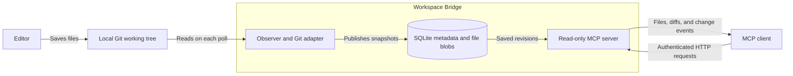
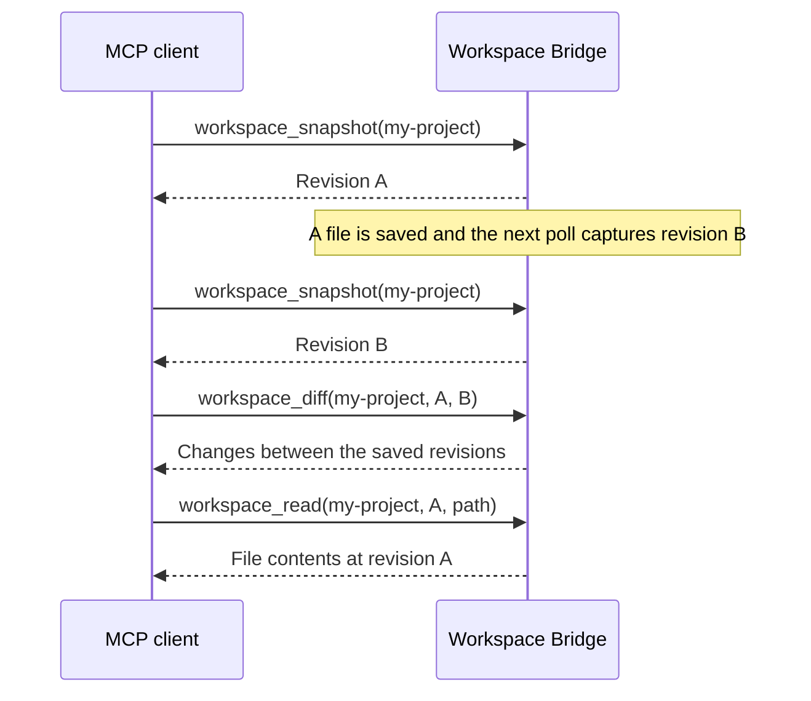

# Workspace Bridge

Workspace Bridge gives AI tools a persistent history of the files you save in a
local Git repository. It runs in the background, takes snapshots at regular
intervals, and lets an MCP client read files or compare changes from those snapshots.
MCP (Model Context Protocol) is the interface an AI application uses to call its tools.

This is useful when a client needs to answer questions such as “What changed since
I last looked?” or “What did this file contain before the last edit?” The bridge
keeps collecting snapshots while clients are disconnected, and its history survives
restarts. You do not need to make a Git commit for an edit to appear in that history.

It captures saved files, including eligible uncommitted and untracked files.
Unsaved editor buffers and existing Git commit history are outside its scope.
Clients can inspect snapshots; they cannot edit files, execute commands, or trigger
a capture through MCP.

## Architecture

One Go process handles both observation and client requests. It runs on the machine
that holds the repositories you configure.



The observer captures each configured repository on startup and every 60 seconds
by default. A change to eligible files or repository metadata creates a new revision.
An unchanged capture does not duplicate the previous revision.

Each revision records a file list and references stored file contents. SQLite holds
revision metadata, events, and observation health; a separate blob store holds file
contents, with identical contents shared across revisions. Both live under the
configured storage directory, outside the observed repositories.

Clients query this saved history through a local HTTP endpoint. Reading a revision
does not capture the working tree again, so the same retained revision can be read
after its original files have changed or been deleted.

| Component | Responsibility |
| --- | --- |
| `cmd/workspace-bridge` | CLI commands, startup, and shutdown |
| `internal/config` | YAML configuration and validation |
| `internal/observer` | Capture scheduling and observation health |
| `internal/backends/git` | Enumerating eligible files and reading saved contents |
| `internal/store` | Persistent snapshots, events, and retention |
| `internal/mcpserver` | Read-only tools and HTTP authentication |
| `internal/workspace` | Shared data types and file selection rules |

## Build and install

You need Go **1.26.7 or newer** and Git. The service targets macOS and Linux and
does not require CGO. Git must also be available when the service runs. Linux runtime
behavior remains unverified.

```sh
git clone https://github.com/programmablemike/workspace-bridge.git
cd workspace-bridge
go mod download
go build -trimpath -o bin/workspace-bridge ./cmd/workspace-bridge
```

Install the executable in your user account:

```sh
mkdir -p "$HOME/.local/bin"
install -m 0755 bin/workspace-bridge "$HOME/.local/bin/workspace-bridge"
export PATH="$HOME/.local/bin:$PATH"
workspace-bridge version
```

Add that `PATH` setting to your shell profile to keep it across terminal sessions.
The build output is ignored by Git. `-trimpath` removes local source paths from
the executable.

## Configure

Keep configuration outside the repositories you want to observe. From the cloned
Workspace Bridge directory, copy the example:

```sh
mkdir -p "$HOME/.config/workspace-bridge"
cp examples/bridge.yaml "$HOME/.config/workspace-bridge/bridge.yaml"
chmod 600 "$HOME/.config/workspace-bridge/bridge.yaml"
```

Edit that file and set `workspaces[].root` to the absolute path of an existing
Git working tree. A minimal configuration looks like this; omitted settings use
the defaults listed below:

```yaml
server:
  listen: "127.0.0.1:8765"
  auth_token_env: "WORKSPACE_BRIDGE_TOKEN"
storage:
  path: "~/.local/state/workspace-bridge"
workspaces:
  - id: "my-project"
    name: "My Project"
    backend: "git"
    root: "/absolute/path/to/your/repository"
```

Add another entry under `workspaces` for each repository. Each `id` must be unique
and is the identifier clients use in tool calls. The only supported backend is
`git`; bare repositories are not supported.

Workspace roots, storage paths, and token file paths must be absolute or start
with `~/`. Storage must be outside all observed roots, and observed roots must
not be inside storage. Restart the service after changing configuration.

### Authentication

The server requires a bearer token even on loopback. For an initial session,
generate one in the shell that will start the service:

```sh
export WORKSPACE_BRIDGE_TOKEN="$(openssl rand -hex 32)"
```

Configure your MCP client to use that same value. This command creates a new token
every time it runs; changing the server token also requires updating the client.
The setup command requires OpenSSL.

For a persistent setup, you can instead provision a private token file and set
`server.auth_token_file` to its absolute path. Use file mode `0600`, keep it outside
all observed repositories, and store a token of at least 32 bytes in it. A token
file takes precedence over `auth_token_env`.

### Capture and retention settings

The [example configuration](examples/bridge.yaml) includes all of these settings:

| Setting | Default | Purpose |
| --- | --- | --- |
| `observer.poll_interval` | `60s` | Time between captures |
| `observer.capture_timeout` | `20s` | Maximum duration of a capture |
| `workspaces[].poll_interval` | Global interval | Optional per-repository interval |
| `capture.max_files` | `5000` | Maximum eligible paths per capture |
| `capture.max_file_bytes` | `1048576` (1 MiB) | Larger files have their contents omitted |
| `capture.max_total_bytes` | `52428800` (50 MiB) | Maximum captured bytes per capture |
| `storage.retention_days` | `7` | Age limit for older revisions |
| `storage.max_bytes` | `1073741824` (1 GiB) | Soft budget for retained file contents |

Exceeding the file count or total capture size fails that capture and preserves
the last successful snapshot. Retention always keeps each workspace's newest
revision, so the storage budget is not a hard disk quota. It also excludes SQLite
metadata and filesystem overhead.

Use `capture.exclude` to omit additional paths, and `capture.allow` to restrict
capture to selected patterns. Patterns match paths relative to the repository
root; `**` matches across directories. For example:

```yaml
capture:
  exclude:
    - "**/credentials/**"
    - "**/*.secret"
  allow:
    - "**/*.go"
    - "go.mod"
    - "README.md"
```

Built-in exclusions cover common credential files such as `.env` and private keys,
as well as common dependency and build directories. Allow patterns cannot override
those exclusions. Git-ignored untracked files are skipped; tracked files still need
capture exclusions if you want to omit them. Review the selected files: these rules
are not a complete secret scanner.

## Start and connect

Validate configuration and capture an initial snapshot:

```sh
workspace-bridge doctor --config "$HOME/.config/workspace-bridge/bridge.yaml"
```

`doctor` writes snapshots to storage; it is not a dry run. A successful result
reports `configuration`, `storage`, `capture`, and `authentication_configured` as
`true`. Then start the service in the foreground:

```sh
workspace-bridge serve --config "$HOME/.config/workspace-bridge/bridge.yaml"
```

Keep that process running while you want to collect snapshots. Press Ctrl-C to
stop it. For continuous operation, run the same command through your service
manager with the configured token available to the process.

Configure an MCP client with:

| Client setting | Value |
| --- | --- |
| Transport | Streamable HTTP |
| URL | `http://127.0.0.1:8765/mcp` |
| Header | `Authorization: Bearer <your token>` |

Use the literal address `127.0.0.1` with the default configuration. The server only
binds to loopback, and the client must reach that same machine's loopback interface.
One token grants access to all configured workspaces. For an OpenClaw client,
see the [OpenClaw setup guide](examples/openclaw.md).

Call `workspace_list` to find configured repositories, then `workspace_status` to
check capture health. The HTTP `/healthz` endpoint only reports server readiness;
it does not prove captures are succeeding.

## Read snapshots and changes

A typical client workflow is to remember a revision, return after a later capture,
and compare the two:



These labels summarize tool calls. For example, the actual arguments to
`workspace_diff` are:

```json
{
  "workspace_id": "my-project",
  "from_revision": "<revision A>",
  "to_revision": "<revision B>"
}
```

| Tool | What it provides |
| --- | --- |
| `workspace_list` | Configured workspaces |
| `workspace_info` | Workspace details, capabilities, and health |
| `workspace_status` | The same observation information as `workspace_info` |
| `workspace_snapshot` | Latest saved revision ID and metadata |
| `workspace_files` | Files in a saved revision |
| `workspace_read` | A file's text at a specified revision |
| `workspace_diff` | Changes between two revisions |
| `workspace_changes` | Revision events since a client's saved cursor |

Revisions are bridge snapshots, not Git commits. Clients must poll for changes;
the bridge does not send notifications or start agent turns. Old revisions expire
according to retention settings. See the [behavior and protocol reference](docs/reference.md)
for tool arguments, pagination, response limits, exclusions, and storage behavior.

## Local administration

Only one process can open a storage directory at a time. Stop `serve` before
running `doctor`, `capture`, `status`, or `forget`. Use MCP tools to inspect the
service while it is running.

```sh
# Capture immediately.
workspace-bridge capture my-project --config "$HOME/.config/workspace-bridge/bridge.yaml"

# Inspect the last capture's health.
workspace-bridge status my-project --config "$HOME/.config/workspace-bridge/bridge.yaml"

# Delete this workspace's saved history.
workspace-bridge forget my-project --config "$HOME/.config/workspace-bridge/bridge.yaml"
```

To stop observing a repository permanently, also remove its configuration entry.
Otherwise the next service start captures it again. Saved history can contain
files you have since deleted; `forget` does not guarantee secure disk erasure.

## Development

```sh
make test   # Go tests with the race detector
make check  # go vet and formatting checks
```

Tests use temporary Git repositories and need no external service credentials.
HTTP tests need permission to bind loopback ports. Tests can run offline once the
Go dependencies are available.

## License

[MIT](LICENSE).
